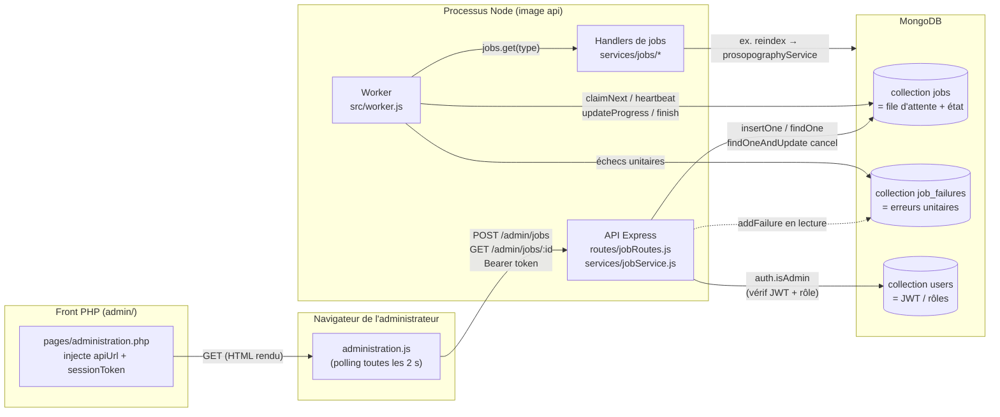
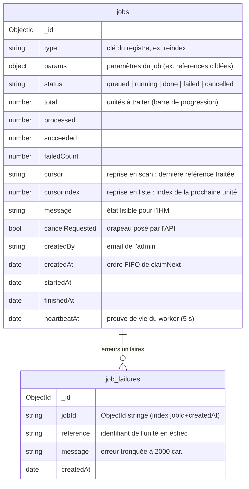
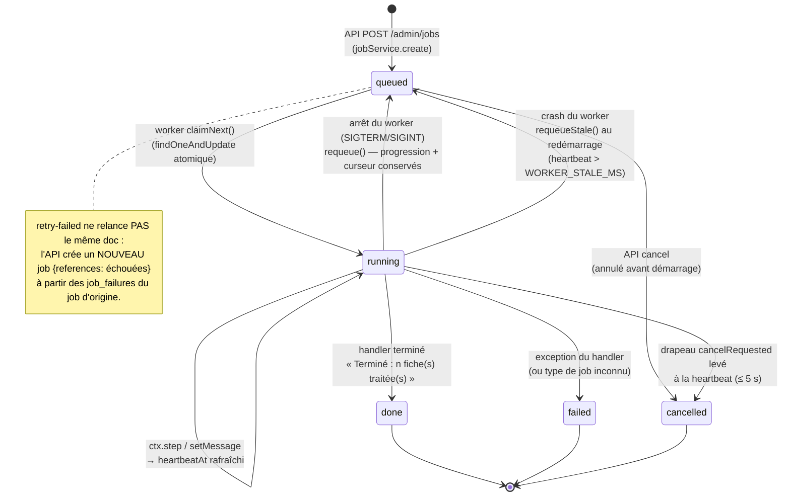
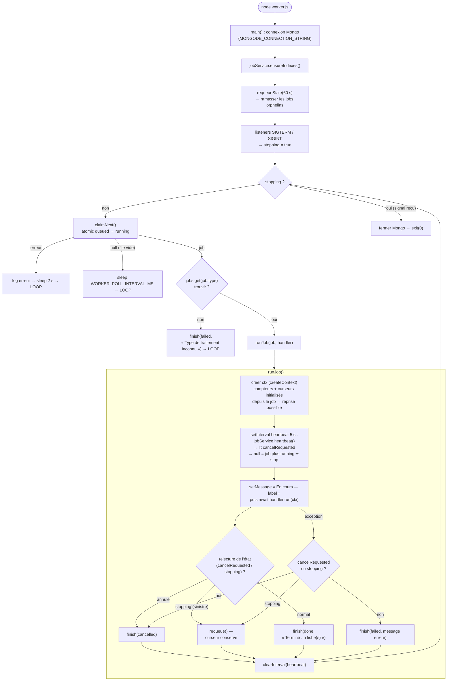
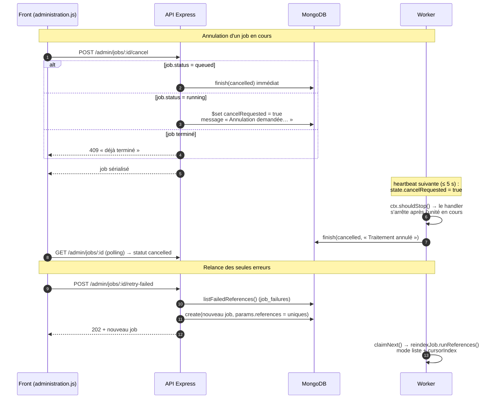
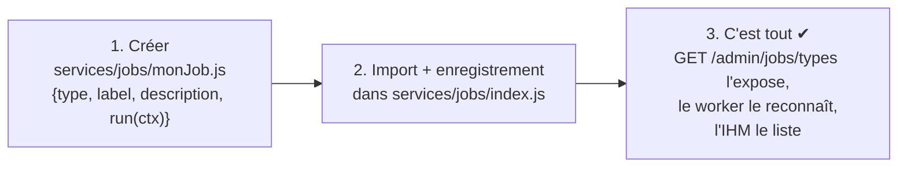

# Traitement des jobs en arrière-plan (`worker.js`)

> Documentation d'architecture — traitements longs exécutés hors du cycle HTTP de l'API.
>
> Fichiers concernés :
> - Worker : [`api/src/worker.js`](../src/worker.js)
> - Persistance / machine à états : [`api/src/services/jobService.js`](../src/services/jobService.js)
> - Routes REST : [`api/src/routes/jobRoutes.js`](../src/routes/jobRoutes.js)
> - Registre des traitements : [`api/src/services/jobs/index.js`](../src/services/jobs/index.js) (exemples : [`reindexJob.js`](../src/services/jobs/reindexJob.js), [`backupJob.js`](../src/services/jobs/backupJob.js), [`restoreJob.js`](../src/services/jobs/restoreJob.js) ; primitives partagées : [`backupLib.js`](../src/services/jobs/backupLib.js))
> - Front admin : [`admin/pages/administration.php`](../../admin/pages/administration.php) + [`admin/resources/js/administration.js`](../../admin/resources/js/administration.js)

---

## 1. Principe général

Le projet sépare strictement **deux processus Node** construits depuis la même image `studium/api` :

| Processus | Rôle | Ne fait **jamais** |
|---|---|---|
| **API** (`server.js`) | Réceive les requêtes HTTP : *empile* des jobs, expose leur état, accepte les demandes d'annulation. | Exécuter un traitement long. |
| **Worker** (`worker.js`) | Réclame les jobs en attente dans MongoDB, exécute le handler correspondant, persiste progression et curseurs. | Servir du HTTP. |

**MongoDB est le seul canal de communication** entre les deux : la file d'attente est simplement la collection `jobs` filtrée sur `status: 'queued'`. Il n'y a ni Redis, ni RabbitMQ, ni file dédiée.

Le front **PHP admin** ne fait pas transiter les appels de jobs : il sert la page et injecte dans le HTML le `sessionToken` et l'URL publique de l'API ; c'est le **JavaScript du navigateur** (`administration.js`) qui rappelle l'API en direct (`fetch` + `Authorization: Bearer …`).



Points clés à retenir :

- **Un job = un document Mongo**, pas un objet en mémoire. L'API peut redémarrer, le worker peut être tué : la file survit.
- Le worker **sonde** Mongo (`claimNext` toutes les 2 s en moyenne) ; le front **sonde** l'API (toutes les 2 s tant que le job est actif). Deux polling indépendants, pas de WebSocket.
- L'annulation est **asynchrone** : l'API pose un simple drapeau `cancelRequested`, le worker le découvre à la heartbeat suivante et s'arrête après l'unité de travail en cours.

---

## 2. Qui fait quoi

### 2.1 Front PHP admin

- `pages/administration.php` : gabarit Bootstrap (sélecteur de type, bouton *Lancer*, panneau de progression, bouton *Annuler* / *Relancer les erreurs*, tableau d'historique). Il n'embarque aucune logique métier.
- `pages/common/footer.php` : définit les variables JS globales `apiUrl` (`PUBLIC_API_URL`) et `sessionToken` (jeton JWT stocké dans `$_SESSION['token']` à la connexion).
- `resources/js/administration.js` : tout le comportement réel — appels REST, rendu de la progression, orchestration du polling :
  - au chargement : `GET /admin/jobs/types` (remplit le sélecteur) + `GET /admin/jobs?limit=10` (historique) ;
  - si un job `isActive` existe déjà, la page s'y **rattache automatiquement** (`attachToJob`) — on peut fermer et rouvrir la page sans rien perdre ;
  - `poll(jobId)` se reprogramme via `setTimeout` toutes les 2 s (5 s en cas d'erreur réseau) tant que `job.isActive` ;
  - sur `POST /admin/jobs` en **409** (type déjà en cours), le front récupère le job existant renvoyé dans l'erreur et s'y rattache au lieu de bloquer.

### 2.2 API Node (Express)

- Montée dans `routes.js` : `router.use('/admin/jobs', jobRoutes)` — avant le `/admin` générique, pour éviter les collisions.
- Toutes les routes sont derrière `auth.isAdmin = [getAuth, getUser, getRoleAdmin]` (passport-jwt → recherche de l'utilisateur → contrôle du rôle `admin`).
- `jobRoutes.js` ne fait **qu'appeler `jobService`** (création, lecture, annulation, relance) et `jobs/index.js` (validation du type, liste des types). Aucun `setTimeout`, aucune exécution de handler dans le processus HTTP.
- Réponses caractéristiques :
  - `POST /admin/jobs` → **202 Accepted** + job sérialisé (le traitement n'a pas commencé, et c'est normal) ;
  - type déjà actif → **409** + job existant ;
  - `GET /admin/jobs/:id` → job sérialisé + 50 dernières `failures`.

### 2.3 Worker

- `main()` : connexion Mongo → `ensureIndexes()` → `requeueStale()` (ramasse les orphelins d'un crash précédent) → installation des listeners `SIGTERM`/`SIGINT` → `loop()` infinie.
- `loop()` : `claimNext()` atomique → résolution du handler via le registre → `runJob()`.
- `runJob()` : crée le contexte `ctx`, démarre un **timer de heartbeat** (5 s), attend `handler.run(ctx)`, puis **clôture dans un des trois cas** : annulé / remis en file (arrêt du worker) / terminé.
- Un seul job à la fois par worker. Pour monter en débit : lancer plusieurs réplicas — `claimNext` est atomique (`findOneAndUpdate`), deux workers ne prendront jamais le même job.

### 2.4 jobService (le contrat commun API ↔ Worker)

Machine à états et persistance, utilisées **des deux côtés** :

| Fonction | Utilisée par | Rôle |
|---|---|---|
| `create` | API | Insère le job en `queued` (refuse si un job du même type est actif, sauf `allowConcurrent`). |
| `list` / `get` / `serialize` | API | Lecture pour l'IHM (`serialize` calcule `percent`, `isActive`, `durationMs` et masque la liste brute `params.references`). |
| `cancel` | API | `queued` → `cancelled` immédiat ; `running` → pose `cancelRequested: true`. |
| `claimNext` | Worker | `findOneAndUpdate {status:'queued'} → 'running'`, tri `createdAt` FIFO. |
| `heartbeat` | Worker | Rafraîchit `heartbeatAt` **et renvoie le document frais** → permet de capter `cancelRequested`. Renvoie `null` si le job n'est plus `running` (récupéré ailleurs → le worker s'arrête). |
| `setTotal` / `setMessage` / `updateProgress` / `addFailure` | Worker (via `ctx`) | Progression et erreurs unitaires. |
| `requeueStale` | Worker (démarrage) | Tout job `running` dont le `heartbeatAt` a plus de 60 s est remis en `queued`. |
| `requeue` | Worker (arrêt) | Remet le job courant en file en conservant progression + curseur. |
| `finish` | API (cancel) + Worker | Clôture : `done` / `failed` / `cancelled`. |

### 2.5 Registre des handlers (`services/jobs/`)

- Chaque traitement est un fichier exportant `{ type, label, description, allowConcurrent?, unitLabel?, finalMessage?, run(ctx) }` (`unitLabel` : nom de l'unité de travail affiché par l'IHM ; `finalMessage` : message de clôture personnalisé).
- `index.js` l'enregistre dans `handlers`. **Rien d'autre à modifier** : l'API l'expose via `GET /admin/jobs/types` (donc dans le sélecteur du front), et le worker le résout par `jobs.get(job.type)`.
- Les handlers ne touchent **jamais** directement à la collection `jobs` : tout passe par `ctx`, ce qui garantit la cohérence compteurs + curseur.

---

## 3. Modèle de données MongoDB



Index créés au démarrage du worker (`ensureIndexes`) :

- `jobs` : `{status, createdAt}` (file + historique), `{type, status}` (contrôle d'anti-concurrence) ;
- `job_failures` : `{jobId, createdAt}` (liste des erreurs, extraction des références pour `retry-failed`).

Les erreurs unitaires sont stockées **à part** pour ne pas faire grossir le document `jobs` (un job qui touche 100 000 fiches ne doit pas créer un doc BSON surdimensionné) et pour pouvoir relancer uniquement les fiches en échec.

---

## 4. Flux complet : lancer et suivre un job

```mermaid
sequenceDiagram
    autonumber
    actor Admin as Administrateur<br/>(navigateur)
    participant PHP as Front PHP<br/>(administration.php)
    participant API as API Express<br/>(jobRoutes)
    participant Mongo as MongoDB<br/>(collection jobs)
    participant W as Worker<br/>(worker.js)
    participant H as Handler<br/>(ex. reindexJob)

    Note over Admin,Mongo : Phase 0 — page et types
    Admin->>PHP : GET / (session admin)
    PHP-->>Admin : HTML + apiUrl + sessionToken<br/>+ administration.js
    Admin->>API : GET /admin/jobs/types (Bearer)
    API-->>Admin : [{type, label, description}] (via registre)
    Admin->>API : GET /admin/jobs?limit=10
    API->>Mongo : list()
    API-->>Admin : historiques sérialisés
    Note over Admin : si un job est isActive,<br/>rattachement automatique

    Note over Admin,Mongo : Phase 1 — création (le HTTP repart tout de suite)
    Admin->>API : POST /admin/jobs {type, params}
    API->>Mongo : create() — 409 si job actif du même type
    Mongo-->>API : doc inséré (status=queued)
    API-->>Admin : 202 Accepted + job sérialisé

    Note over W,Mongo : Phase 2 — le worker prend la main
    loop Boucle de polling (2 s si file vide)
        W->>Mongo : claimNext() findOneAndUpdate atomique
        Mongo-->>W : job (queued → running)
    end
    W->>W : jobs.get(type) → handler
    W->>Mongo : setMessage("En cours — <label>")
    W->>H : handler.run(ctx)

    Note over W,H : Phase 3 — exécution pilotée par ctx
    H->>Mongo : ctx.setTotal(n)
    loop Pour chaque unité de travail
        H->>H : if ctx.shouldStop() → return
        H->>H : travail réel (ex. service.reindexFromRaw)
        H->>Mongo : ctx.step({reference, success, cursor})
        Note right of Mongo : compteurs + curseur persistés<br/>+ heartbeat ; échec → job_failures
    end
    loop Heartbeat (5 s)
        W->>Mongo : heartbeat() → renvoie cancelRequested
    end

    Note over W,Mongo : Phase 4 — clôture
    W->>Mongo : finish(done|cancelled) ou requeue si stopping

    Note over Admin,API : Phase 5 — suivi côté front
    loop Toutes les 2 s tant que job.isActive
        Admin->>API : GET /admin/jobs/:id
        API->>Mongo : get() + listFailures(50)
        API-->>Admin : percent, message, failures…
    end
    Admin->>Admin : rendu terminé → rechargement de l'historique
```

---

## 5. Cycle de vie d'un job (machine à états)



Deux chemins de retour `running → queued` se distinguent :

| | `requeue` (arrêt propre) | `requeueStale` (crash) |
|---|---|---|
| Déclencheur | `SIGTERM`/`SIGINT` reçu, `stopping = true` | Worker mort sans signaler ; au **démarrage** d'un worker |
| Détection | immédiate, dans `runJob` | `heartbeatAt` plus vieux que 60 s |
| Message | « Interrompu par l'arrêt du worker, reprise automatique » | « Reprise après interruption du worker » |
| Progression | conservée intégralement | conservée **au dernier `ctx.step` près** (unités en cours perdues → retratées) |

C'est ce qui rend le système **rejouable sans perte** : re-déploiement, montée de version du worker ou simple `docker stop` ne cassent aucun traitement.

---

## 6. Vue interne du worker



### Le contexte `ctx` fourni aux handlers

| Méthode | Effet |
|---|---|
| `ctx.job` | Document brut du job (`params`, `cursor`, `cursorIndex`…). |
| `ctx.logger` | Logger Winston du worker. |
| `ctx.setTotal(n)` | Persiste le total (barre de progression). Rafraîchit la heartbeat. |
| `ctx.setMessage(str)` | Message d'état lisible affiché dans l'IHM. |
| `ctx.step({reference, success, error, cursor, cursorIndex})` | Incrémente `processed` + `succeeded` **ou** `failedCount` (+ insertion dans `job_failures`), persiste le curseur et la progression. **C'est le point de reprise.** |
| `ctx.shouldStop()` | `true` si annulation demandée **ou** arrêt du worker en cours — à tester entre chaque unité. |
| `ctx.isCancelled()` | `true` pour annulation utilisateur uniquement. |
| `ctx.counters()` | Compteurs + curseurs courants (message final personnalisé). |

### Exemple : `reindexJob.js`

- Deux modes selon `params.references` :
  - **scan complet** (`runAll`) : pagination par lots de 100 références triées, `cursor` = dernière référence traitée → la reprise reprend *après* ;
  - **liste ciblée** (`runReferences`, produit de `retry-failed`) : `cursorIndex` = index de la prochaine unité.
- Chaque fiche : `service.reindexFromRaw(reference)` avec **3 tentatives** et backoff linéaire (500 ms, 1 s), `ctx.step` appelé même en cas d'échec définitif (pour ne pas bloquer la reprise sur une fiche cassée).
- Vérifie `ctx.shouldStop()` avant chaque page et chaque fiche.

### Exemple : `backupJob.js` — sauvegarde de la base

- **Unité de travail = collection** (`unitLabel: 'collection'`) : le type apparaît dans le sélecteur de la page d'administration, et le panneau de suivi affiche « *n* collection(s) ».
- Dump **natif Node** : `find({}, { raw: true })` renvoie les octets BSON stockés par le serveur (vérifiés **identiques octet à octet** à ceux d'un `mongodump` officiel) ; chaque collection est écrite gzipée dans `<BACKUP_DIR>/studium-<horodatage>/<db>/<coll>.bson.gz` (+ `.metadata.json.gz` pour les index), format lisible tel quel par `mongorestore --gzip`. Aucun binaire externe à installer sur le worker.
- Collection terminée → `ctx.step({ reference, cursor })` ; échec → erreur unitaire, **curseur non avancé** (la reprise la retentera). Une fois tout réussi, `tar -cf` produit `studium-<horodatage>.tar`, le répertoire intermédiaire est supprimé et `finalMessage` affiche le chemin et la taille de l'archive.
- Des échecs ⇒ **aucune archive** et job `failed` : « Relancer les erreurs » relance uniquement les collections en échec (via `params.references`) et produit une archive `…-partiel.tar`.
- Ignorées par défaut : `system.*`, `logs`, `jobs`, `job_failures` (param `params.excludedCollections` pour en ajouter).
- L'ancienne route HTTP `POST /admin/backup` (utilisée par le CLI) empile désormais ce job au lieu d'exécuter le dump dans le processus API.

### Exemple : `restoreJob.js` — restauration depuis une archive

- ⚠ **Destructif** : remplace toutes les données de la base courante par le contenu d'une archive produite par `backup` ; le job refuse de démarrer sans `params.confirm = 'RESTAURER'`.
- Trois phases : préparation **non destructive** (dump de sécurité de l'état courant → `studium-pre-restore-<horodatage>.tar`, puis extraction de l'archive), restauration par collection (drop → réinsertion des documents BSON par lots, types conservés grâce à une désérialisation stricte → recréation des index décrits par les `.metadata.json.gz`), puis suppression des collections vivantes absentes du dump.
- `jobs`, `job_failures`, `logs` et `system.*` ne sont **jamais supprimés** : la restauration ne détruit pas la file qui la pilote.
- Idempotent et reprenable (curseur `r:<collection>`) ; en revanche une annulation en phase destructive laisse un état mixte — c'est le rôle de la sauvegarde de sécurité de permettre le retour en arrière.
- La liste des archives exploitables est exposée par `GET /admin/jobs/backups` et présentée dans la carte « Restauration de la base » de l'IHM admin (sélection de l'archive, option de pre-backup, confirmation par saisie du mot `RESTAURER`).
- Des dumps produits hors du serveur (autre environnement, export manuel) peuvent être importés via `POST /admin/jobs/backups` (bouton « Téléverser une archive… » de la carte « Sauvegarde de la base ») : binaire en corps de requête brut, renommé `studium-upload-…tar` et vérifié (`tar -tf` + présence de `.bson.gz`) avant d'atterrir dans `BACKUP_DIR`, donc immédiatement restaurable. Le volume `backups` est à ce titre monté en écriture dans `studium_api` (voir `docker-compose.yml`).
- Les archives sont supprimables via `DELETE /admin/jobs/backups/:name` (bouton rouge « Supprimer », avec confirmation, dans la liste « Sauvegardes disponibles » de la carte « Sauvegarde de la base ») ; la suppression est refusée (409) tant qu'un traitement `restore` en file ou en cours référence l'archive.
- Primitives de dump partagées avec `backupJob` dans [`services/jobs/backupLib.js`](../src/services/jobs/backupLib.js).

---

## 7. Annulation et relance des erreurs



Le polling du front passe à 1 s juste après une demande d'annulation (`schedulePoll(id, 1000)`) pour afficher rapidement la transition.

---

## 8. Sécurité et authentification

- `jobRoutes.js` applique d'abord `auth.isAdmin` à **toutes** ses routes : passport-jwt (vérification du Bearer), chargement de l'utilisateur Mongo par email, contrôle `role.includes('admin')`.
- La chaîne de confiance du front : connexion PHP → JWT stocké dans `$_SESSION['token']` → injecté dans le HTML (`footer.php`) → header `Authorization` de chaque `fetch`. PHP ne relaie jamais les appels jobs ; le navigateur parle directement à l'API (via le proxy nginx `/api/` en production).
- Conséquence : si l'admin ferme la page ou si le token expire, le job **continue** (worker indépendant) ; un rechargement avec un nouveau token permet de s'y rattacher via l'historique.

## 9. Déploiement et configuration

`docker-compose.yml` à la racine définit trois services ; l'API et le worker partagent la **même image** `studium/api`, seule la commande change :

| Service | Commande | Particularités |
|---|---|---|
| `studium_api` | entrypoint normal (port 3000) | jamais de traitement long |
| `studium_worker` | `node worker.js` (bundle webpack) | `restart: unless-stopped`, `stop_grace_period: 30s` (laisse finir l'unité de travail courante avant le `requeue`) |
| `studium_admin` | PHP + nginx | expose `/api/` → `studium_api:3000` |

Variables d'environnement du worker :

| Variable | Défaut | Effet |
|---|---|---|
| `MONGODB_CONNECTION_STRING` | — (requis) | même base que l'API |
| `WORKER_POLL_INTERVAL_MS` | `2000` | pause entre deux `claimNext` quand la file est vide |
| `WORKER_HEARTBEAT_MS` | `5000` | période de heartbeat → latence max d'une annulation |
| `WORKER_STALE_MS` | `60000` | seuil au-delà duquel un `running` est considéré orphelin |
| `BACKUP_DIR` | `backupDir` de `config.json`, puis `/var/backups/studium` | destination des dumps et archives du job `backup` |
| `BACKUP_UPLOAD_MAX_BYTES` | `2147483648` (2 Go) | taille maximale acceptée par `POST /admin/jobs/backups` (API) |

Le `docker-compose.yml` monte le volume nommé `backups` sur
`/var/backups/studium` dans `studium_worker` (lecture/écriture, pour les
dumps) et dans `studium_api` (écriture également, pour le téléversement
d'archives) : les sauvegardes survivent aux
reconstructions du conteneur (et peuvent être copiées/snapshotées depuis ce
volume). L'archive n'étant pas chiffrée, la rétention et la sortie hors site
relèvent de l'exploitation (cron de copie, chiffrement, etc.).

Pour les téléversements, la taille est aussi bornée par le proxy :
`client_max_body_size` du nginx de `docker-compose.yml` (`2g`) — et, s'il y a
un reverse proxy externe devant l'app, sa propre limite est à aligner.

En développement : `npm run worker` (babel-node) ou `npm run worker:watch` — à lancer **à côté** de l'API.

## 10. Ajouter un nouveau traitement (checklist)



Règles pour l'auteur du handler :

1. Toujours vérifier `ctx.shouldStop()` **entre chaque unité** de travail et faire `return` sans lever d'erreur.
2. Appeler `ctx.step()` pour **chaque** unité (y compris en échec : `success: false, reference, error`) — c'est ce qui persiste compteurs, `job_failures` et curseur de reprise.
3. Choisir le bon curseur : `cursor` pour un scan continu (dernière référence traitée), `cursorIndex` pour une liste indexée.
4. Ne jamais écrire dans la collection `jobs` directement ; ne pas rattraper une exception globale si le job doit être marqué `failed` (la lever : `runJob` appellera `finish(failed)`).
5. Envisager l'idempotence : après un crash, l'unité en cours au moment de la heartbeat expirée sera **retraitée** (au moins une fois sémantique).

## 11. Limites connues et choix assumés

- **Polling, pas d'événementiel** : latence de démarrage ≈ 1 cycle de polling (2 s), latence d'annulation ≈ 1 heartbeat (5 s). Suffisant pour des traitements de plusieurs minutes.
- **Anti-concurrence au niveau du type** (`findActiveByType`) : fait en lecture + insert, non transactionnel — deux POST simultanés du même type peuvent théoriquement passer. Le `claimNext` atomique, lui, protège réellement l'exécution multi-workers.
- **`retry-failed` crée un nouveau job** (traçabilité propre) au lieu de réouvrir l'ancien.
- **Reprise « at-least-once »** : après crash dur, la fiche en cours au moment de la mort est reprise depuis le dernier `ctx.step`, donc potentiellement retraitée une fois — d'où l'exigence d'idempotence des handlers.
- Pour du débit supérieur : répliquer le worker (`replicas`), pas besoin de code supplémentaire grâce à `claimNext`.

---

*Voir aussi : [`api/src/services/jobs/README.md`](../src/services/jobs/README.md) (guide développeur du registre) et [`doc.md`](../../doc.md) à la racine.*
