# Studium Parisiense — Documentation Technique

> **Studium Parisiense** est une application web de base de données prosopographique dédiée aux membres des écoles et de l'Université de Paris entre le XIIe et le XVIe siècle. Projet du programme de recherche européen *Signs and States* dirigé par Jean-Philippe Genet (ERC).

---

## 1. Architecture générale

L'application suit une architecture **trois tiers** :

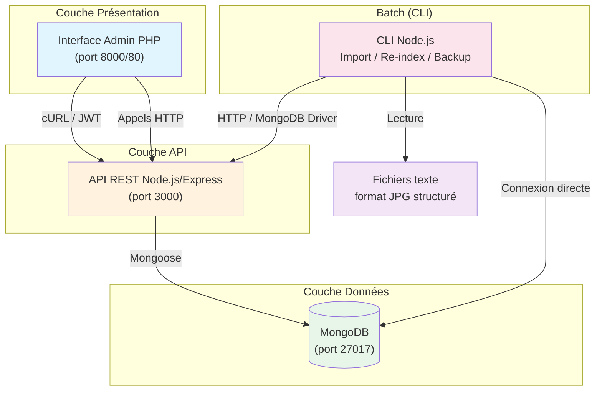

---

## 2. Stack technologique

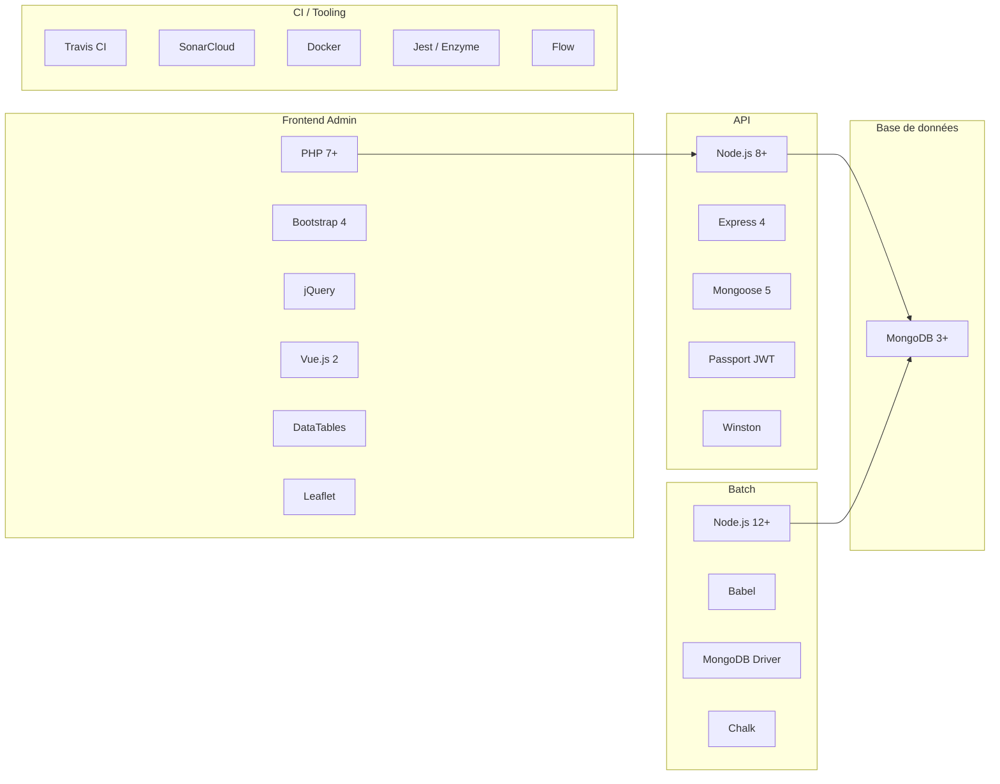

---

## 3. Structure du projet

```
studium/
├── api/                  # API REST (Node.js/Express)
│   ├── config/           # Configuration (env, JWT, MongoDB)
│   ├── docker/           # Dockerfile et docker-compose
│   ├── docs/             # Documentation Swagger (HTML + OpenAPI)
│   ├── resources/json/   # Fichiers GeoJSON (données cartographiques)
│   ├── src/
│   │   ├── models/       # Modèles Mongoose (User)
│   │   ├── routes/       # Définition des routes Express
│   │   ├── services/     # Logique métier
│   │   └── utils/        # Utilitaire (DB, Logger, Export)
│   ├── tests/
│   └── types/            # Types Flow
│
├── admin/                # Interface d'administration (PHP)
│   ├── src/              # Services PHP (FicheService, UserService...)
│   ├── pages/            # Pages HTML/PHP
│   │   ├── common/       # Header, Footer, Login
│   │   └── view/         # Composants de vue
│   ├── resources/        # CSS, JS, icônes
│   └── mock/             # Réponses mock API pour développement
│
├── batchs/               # Traitements par lots (Node.js CLI)
│   ├── src/
│   │   ├── rawFilesParser/    # Parseur de fichiers texte JPG
│   │   │   └── util/          # Parseurs spécialisés (dates, noms, lieux...)
│   │   ├── fileImporter/      # Import de fichiers JSON
│   │   ├── placesextractor/   # Extraction de lieux
│   │   └── msextractor/       # Extraction de manuscrits
│   ├── tests/
│   │   └── data/              # Données de test
│   └── cmd                     # Binaire CLI
│
├── scripts/              # Scripts MongoDB (export CSV, dédoublonnage)
├── docker-compose.yml    # Orchestration complète
├── .travis.yml           # CI Travis
└── sonar-project.properties
```

---

## 4. Composant API (Node.js / Express)

### 4.1 Routage

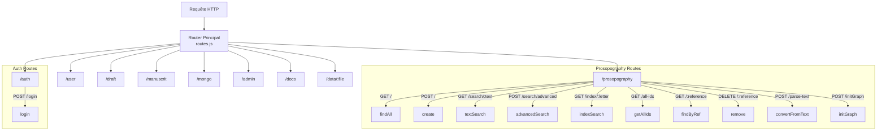

### 4.2 Services

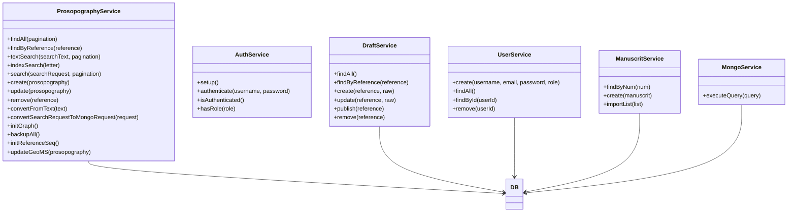

---

## 5. Composant Admin (PHP)

### 5.1 Contrôleur frontal

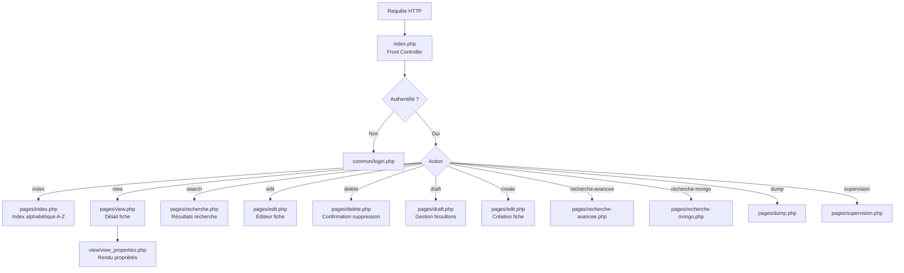

### 5.2 Services PHP

```mermaid
classDiagram
    class FicheService {
        +searchByIndex(letter)
        +searchByReference(reference)
        +searchByKeyWord(keyword, page, rows)
        +saveFicheFromText(reference, raw)
        +removeFicheByReference(reference)
        +getDraftByReference(reference)
        +getDrafts()
    }

    class UserService {
        +authenticate(username, password)
        +getToken()
    }

    class ManuscritService {
        +getManuscrit(num)
    }

    class Utils {
        +callAPI(method, url, data)
        +getFieldFromForm(name)
        +isAuthenticated()
    }

    FicheService --> Utils
    UserService --> Utils
    ManuscritService --> Utils
    Utils -->|"cURL"| API["API REST Node.js"]
```

---

## 6. Composant Batch (Node.js CLI)

### 6.1 Commandes disponibles

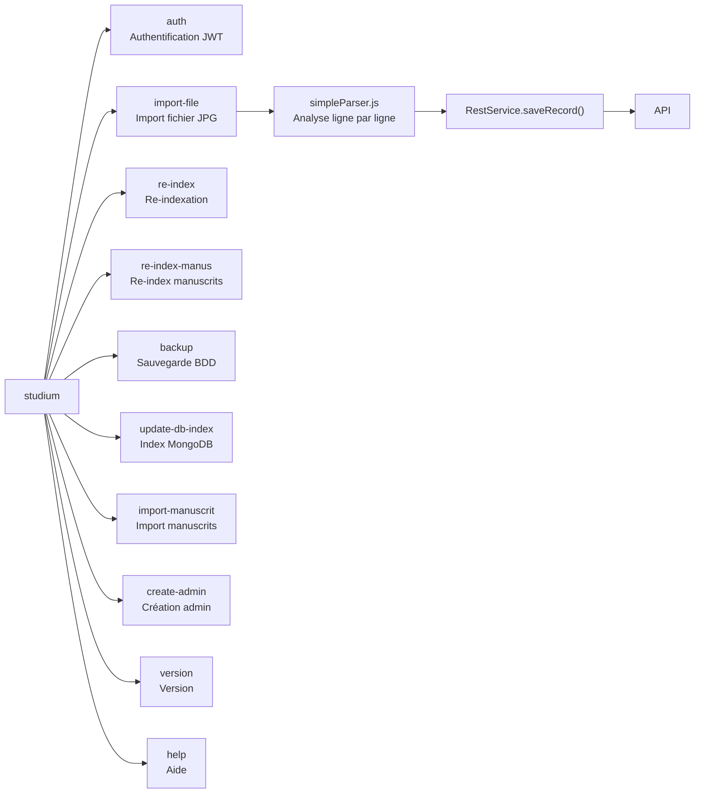

### 6.2 Parseur de fichiers texte (format JPG)

Le parseur lit les fichiers texte structurés avec des **codes de ligne** spécifiques :

```mermaid
stateDiagram-v2
    [*] --> NEW_PROSO: Ligne <1a>
    NEW_PROSO --> DATA: Ligne <code>
    DATA --> DATA: Même code
    DATA --> NEW_OPUS: Ligne <Na>
    NEW_OPUS --> OPUS_DATA: Ligne <<code>>
    OPUS_DATA --> OPUS_DATA: Même code
    OPUS_DATA --> NEW_VERSION: Ligne <<<k>>> 
    NEW_VERSION --> VERSION_DATA: Ligne <<<code>>>
    VERSION_DATA --> VERSION_DATA: Même code
    OPUS_DATA --> DATA: Nouveau code data
    NEW_OPUS --> DATA: Nouveau code data
    DATA --> NEW_PROSO: Nouveau <1a>
    NEW_PROSO --> [*]: Fin fichier

    note right of NEW_PROSO
        Codes principaux:
        <1a> = Nouvelle fiche
        <r>  = Référence
        <Na> = Nouvel opus
        <<code>> = Données opus
        <<<k>>> = Nouvelle version
        <code>/ = Commentaire
    end note
```

### 6.3 Structure des données extraites

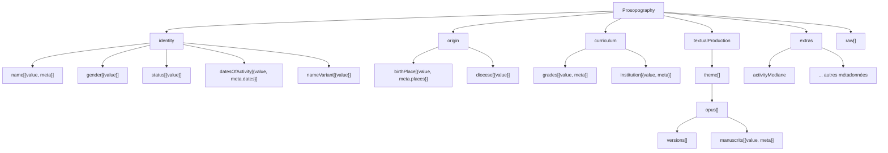

---

## 7. Flux d'authentification

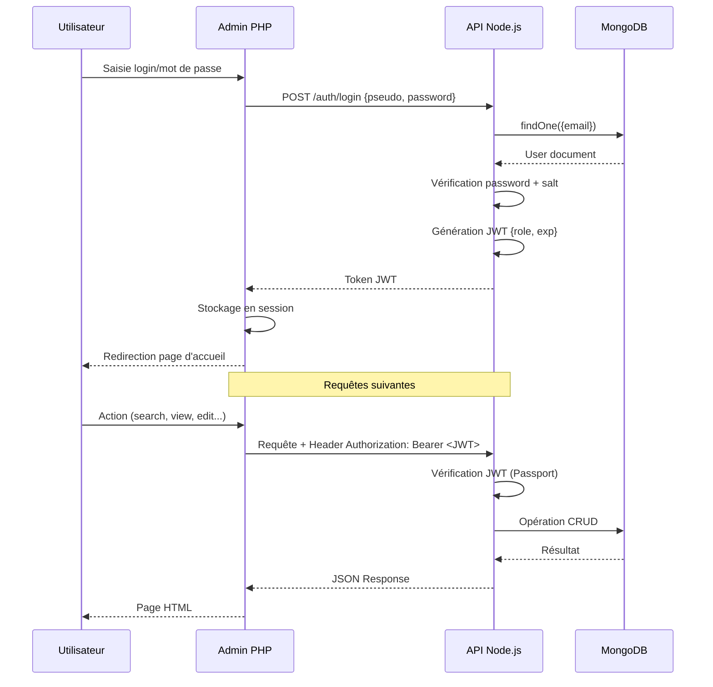

---

## 8. Flux de données : import de fichier

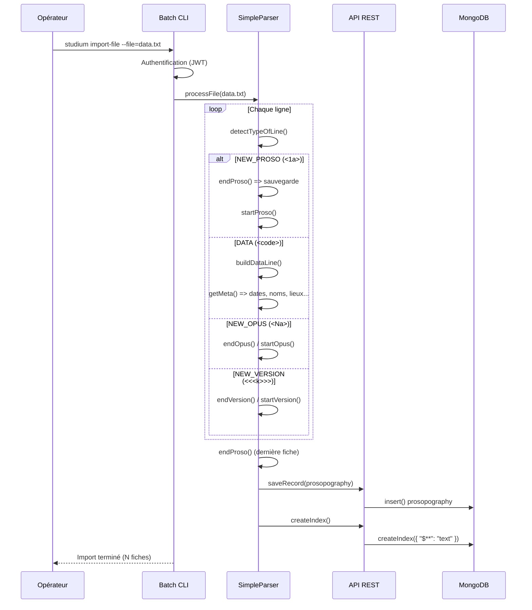

---

## 9. Modèle de données MongoDB

### Collections

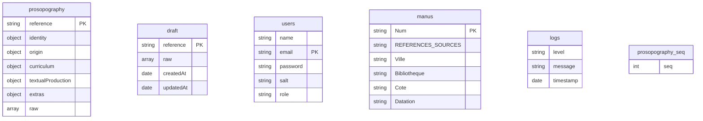

### Structure d'une fiche prosopographique (exemple simplifié)

```json
{
  "reference": "50001",
  "identity": {
    "name": [{ "value": "Johannes de Gerson", "meta": { "names": [...] } }],
    "gender": [{ "value": "M" }],
    "status": [{ "value": "Magister" }],
    "datesOfActivity": [{ "value": "1390-1420", "meta": { "dates": [...] } }]
  },
  "origin": {
    "birthPlace": [{ "value": "Gerson", "meta": { "places": [...] } }],
    "diocese": [{ "value": "Reims" }]
  },
  "curriculum": {
    "grades": [{ "value": "Doctor en Theologie" }],
    "institution": [{ "value": "Université de Paris" }]
  },
  "textualProduction": [{
    "theme": "Theologie",
    "opus": [{
      "title": [{ "value": "De consolatione theologiae" }],
      "manuscrits": [{ "value": "Paris, BnF, lat. 1234" }],
      "versions": [...]
    }]
  }],
  "extras": {
    "activityMediane": 1400
  },
  "raw": ["<1a>...", ...]
}
```

---

## 10. Déploiement

### 10.1 Docker Compose

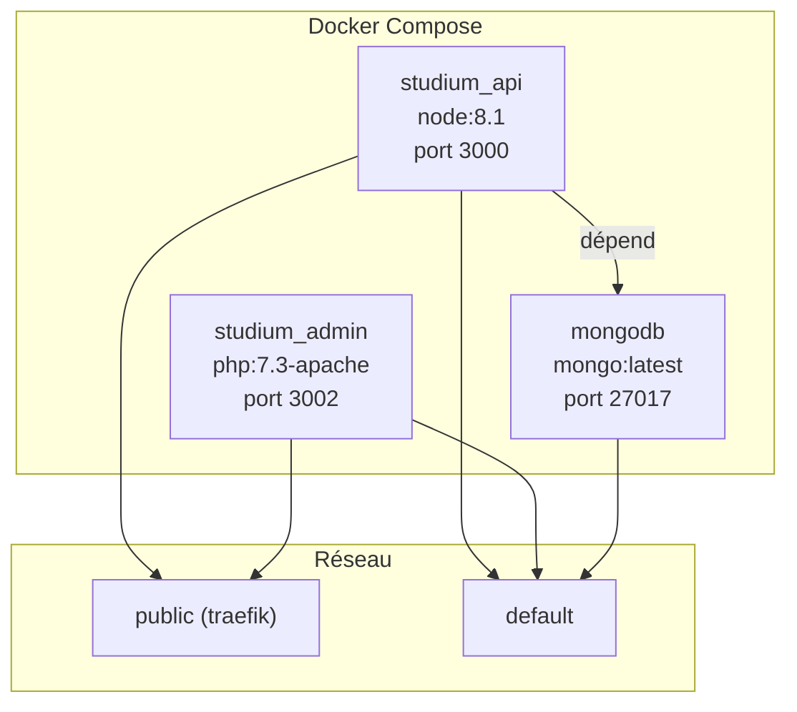

### 10.2 Installation manuelle

```bash
# 1. Installer MongoDB 3+
# 2. Batch - Installer les dépendances et créer l'admin
cd batchs && npm i && npm start -- create-admin

# 3. API - Installer et démarrer
cd api && npm i && npm start
# => API disponible sur http://localhost:3000

# 4. Admin - Démarrer le serveur PHP
cd admin && bin/start.sh
# => Interface disponible sur http://localhost:8000
```

---

## 11. Tests et CI

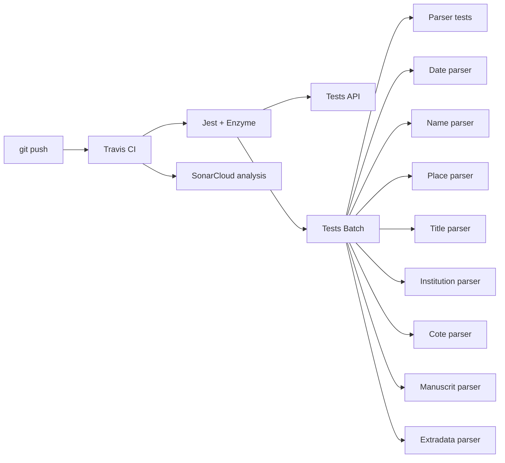

---

## 12. API REST — Résumé des endpoints

| Groupe | Méthode | Route | Description |
|--------|---------|-------|-------------|
| **Prosopography** | `GET` | `/prosopography` | Liste toutes les fiches |
| | `POST` | `/prosopography` | Crée une fiche |
| | `GET` | `/prosopography/:reference` | Récupère une fiche |
| | `DELETE` | `/prosopography/:reference` | Supprime une fiche |
| | `GET` | `/prosopography/search/:text` | Recherche textuelle |
| | `POST` | `/prosopography/search/advanced` | Recherche avancée |
| | `GET` | `/prosopography/index/:letter` | Index alphabétique |
| | `GET` | `/prosopography/all-ids` | Tous les IDs |
| | `POST` | `/prosopography/parse-text` | Parse un texte brut |
| | `POST` | `/prosopography/initGraph` | Agrégation graphe |
| | `POST` | `/prosopography/seq/init` | Init séquence |
| | `GET` | `/prosopography/seq/current` | Séquence courante |
| **Auth** | `POST` | `/auth/login` | Authentification |
| **User** | `POST` | `/user` | Crée un utilisateur |
| | `GET` | `/user` | Liste les utilisateurs |
| | `GET` | `/user/me` | Profil courant |
| | `POST` | `/user/init-pwd/:userId` | Reset mot de passe |
| | `DELETE` | `/user/:userId` | Supprime un utilisateur |
| **Draft** | `GET` | `/draft` | Liste les brouillons |
| | `GET` | `/draft/:reference` | Récupère un brouillon |
| | `POST` | `/draft/:reference` | Crée/met à jour |
| | `DELETE` | `/draft/:reference` | Supprime un brouillon |
| | `POST` | `/draft/from-text` | Met à jour depuis texte |
| | `POST` | `/draft/create-from-text` | Crée depuis texte |
| | `POST` | `/draft/publish/:reference` | Publie un brouillon |
| **Manuscrit** | `GET` | `/manuscrit/:num` | Récupère un manuscrit |
| | `POST` | `/manuscrit` | Crée un manuscrit |
| | `POST` | `/manuscrit/list` | Importe une liste |
| **Mongo** | `POST` | `/mongo/executeQuery` | Requête MongoDB directe |
| **Admin** | `POST` | `/admin/*` | Re-index, backup, etc. |
| **Docs** | `GET` | `/docs` | Documentation Swagger |
| **Data** | `GET` | `/data/:file` | Fichiers GeoJSON |

---

## 13. Licence

Studium est publié sous licence **Open Source (MIT)**.

---
*Documentation générée à partir de l'analyse du code source — Juin 2026*
