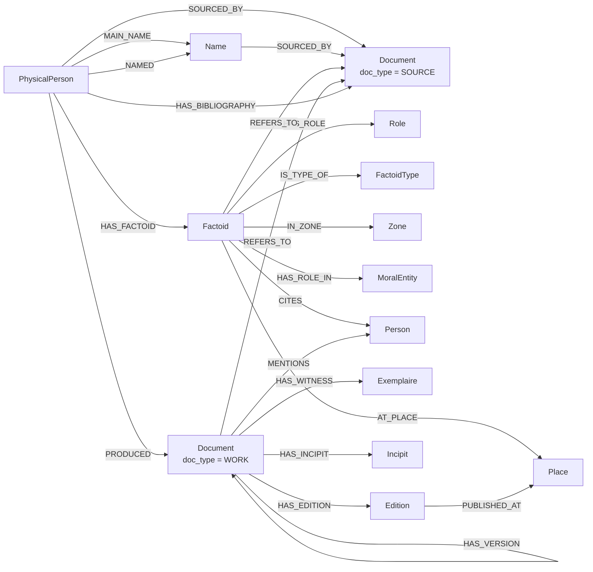

# Modèle de graphe Neo4j — DAPHNE allégé

Ce document décrit le modèle réellement écrit dans Neo4j par le service
d'ingestion de l'API. Il documente chaque label de nœud, chaque type de
relation, les propriétés associées et les règles de fusion.

## 1. Sources du modèle

Le modèle est construit par les fichiers suivants :

- `api/scripts/import-neo4j.js` : CLI d'import (fichier JSON ou collection
  MongoDB) ;
- `api/src/services/graph/identity.js` : personne, noms, sources d'identité ;
- `api/src/services/graph/careers.js` : sections de parcours et `Factoid` ;
- `api/src/services/graph/production.js` : œuvres, témoins, éditions,
  incipits ;
- `api/src/services/graph/bibliography.js` : sources bibliographiques ;
- `api/src/services/graph/model.js` : contexte de construction et
  dédoublonnage ;
- `api/src/services/graph/normalize.js` : nettoyage, normalisation, dates,
  parsing des mentions et des manuscrits ;
- `api/src/services/graph/writer.js` : requêtes Cypher et contraintes ;
- `api/src/services/graph/verify.js` : contrôles d'intégrité après import.

Le schéma conceptuel de référence est `neo4j/schemaDAPHNE_v2.jpg`. Le modèle
appliqué en base est volontairement plus plat : les nœuds intermédiaires
`TimeInterval`, `Participate` et `Named` du schéma DAPHNE ne sont pas créés.

## 2. Vue d'ensemble



Deux labels méritent une attention particulière :

- `Document` est **polymorphe** : il représente soit une source
  bibliographique (`doc_type = 'SOURCE'`), soit une œuvre
  (`doc_type = 'WORK'`). La propriété `doc_type` doit toujours être testée
  dans les requêtes.
- `PhysicalPerson` est la personne décrite par la fiche. `Person` est une
  personne **citée** (co-acteur, dédicataire, auteur mentionné) et ne contient
  pas de biographie complète.

## 3. Conventions générales

### 3.1 Clés et fusion

Tous les nœuds sont fusionnés avec `MERGE` sur `norm_key`, sauf indication
contraire. La personne utilise `person:<mongo_id>` ; les autres entités
utilisent une clé canonique calculée par `normKey` (minuscules, sans accents,
sans ponctuation) ou `sourceNormKey` pour les références bibliographiques.

| Label | Format de `norm_key` |
| --- | --- |
| `PhysicalPerson` | `person:<mongo_id>` |
| `Name` | `name:<mongo_id>:main:<nom normalisé>` ou `name:<mongo_id>:variant:<nom normalisé>` |
| `Document` source | `source:<référence normalisée>` |
| `Document` œuvre | `document:work:<mongo_id>:<section>:<index>:<titre normalisé>` |
| `Document` version | `<norm_key de l'œuvre parente>:version:<index>:<titre normalisé>` |
| `Factoid` | `factoid:<mongo_id>:<section>:<rôle>:<sha1(description, 12)>` |
| `Place` | `place:<lieu normalisé>` |
| `Zone` | `zone:<zone normalisée>` |
| `MoralEntity` | `institution:<nom normalisé>` |
| `Person` | `person:<nom normalisé>` |
| `Exemplaire` | `exemplaire:<norm_key de l'œuvre>:<référence normalisée>` |
| `Edition` | `edition:<norm_key de l'œuvre>:<type>:<sha1(texte, 12)>` |
| `Incipit` | `incipit:<norm_key de l'œuvre>:<kind>:<sha1(texte, 12)>` |
| `Role` | `role:<rôle normalisé>` |
| `FactoidType` | `factoid_type:<catégorie>` |

Pour les sources, `sourceNormKey` ignore en plus les URL, le contenu entre
crochets et les années entre parenthèses. Cela permet de fusionner par exemple
`WEIJERS: 1 (1994), 56-58.` et `WEIJERS: 1, 56-58.`.

### 3.2 Dates

Il n'existe pas de nœud `TimeInterval`. Les dates sont des propriétés plates
sur `Factoid`, `Document` (œuvre) et `Edition` :

| Propriété | Type | Description |
| --- | --- | --- |
| `date_start` | entier | année de début, ou année simple |
| `date_end` | entier | année de fin ; égale à `date_start` pour une date simple |
| `date_type` | chaîne | `INTERVAL` ou `SIMPLE` ; absent si aucune date analysable |
| `date_display` | chaîne | libellé source nettoyé ; peut contenir du texte non daté |

`date_display` conserve la forme lisible de la source. Il ne faut donc pas
supposer qu'il contient toujours une année.

### 3.3 Certitude

La propriété `certainty` prend les valeurs suivantes :

- `certain` : information affirmative ;
- `uncertain` : présence d'un `?` dans la source ;
- `probable` : formulation explicite (`douteu`, `incertain`, `probable`,
  `attribution douteuse`) ;
- `rejected` : uniquement pour `Document.certainty` d'une œuvre rejetée.

Les relations portent aussi une `certainty` lorsqu'un jugement de certitude
s'applique à un lien précis.

### 3.4 Propriétés absentes

Avant l'écriture, la fonction `compact()` supprime les propriétés `null`,
`undefined` et les chaînes vides. Une propriété absente signifie donc « valeur
non renseignée ». Les tableaux vides (`[]`) sont conservés.

### 3.5 Horodatage

- `PhysicalPerson` : `updated_at` seulement ;
- `Name`, `Document`, `Factoid` : `created_at` à la création puis `updated_at`
  à chaque import ;
- les autres labels n'ont pas d'horodatage.

Les valeurs sont des `datetime` Neo4j produites par `datetime()`.

## 4. Types de nœuds

### 4.1 `PhysicalPerson`

Personne décrite par la fiche prosopographique. Il y a une seule
`PhysicalPerson` par fiche importée.

| Propriété | Type | Description / valeur |
| --- | --- | --- |
| `norm_key` | chaîne | `person:<mongo_id>` ; clé unique |
| `mongo_id` | chaîne | identifiant `_id` MongoDB de la fiche |
| `id` | chaîne | alias de `mongo_id` |
| `reference` | chaîne | numéro de la fiche (`487`, `50875`, etc.) |
| `name` | chaîne | nom principal affiché |
| `title` | chaîne | titre de la fiche source |
| `link` | chaîne | URL ou chemin vers la fiche |
| `short_description` | chaîne | description courte |
| `shortdesc` | chaîne | alias de `short_description` |
| `gender` | chaîne | genre (`male`, `female`, etc.) |
| `genre` | chaîne | alias français de `gender` |
| `status` | chaîne | statut (`Maître`, etc.) |
| `life_start` | entier | début de vie |
| `life_end` | entier | fin de vie |
| `life_display` | chaîne | dates de vie telles que fournies |
| `activity_start` | entier | début de période d'activité |
| `activity_end` | entier | fin de période d'activité |
| `activity_display` | chaîne | période d'activité lisible |
| `activityPeriod` | chaîne | alias de `activity_display` |
| `activity_mediane` | entier | année médiane d'activité |
| `updated_at` | datetime | date du dernier import |

Les références d'identité ne sont pas stockées dans `source_keys` : elles
deviennent les relations `SOURCED_BY` vers des `Document` sources.

### 4.2 `Name`

Nom principal ou variante d'une personne. Les noms sont propres à une fiche :
la clé contient le `mongo_id`.

| Propriété | Type | Description / valeur |
| --- | --- | --- |
| `norm_key` | chaîne | `name:<mongo_id>:main:<nom>` ou `name:<mongo_id>:variant:<nom>` |
| `name_id` | chaîne | même valeur que `norm_key` |
| `completeName` | chaîne | nom complet nettoyé |
| `name_type` | chaîne | `MAIN_NAME` ou `NAMED` |
| `certainty` | chaîne | `certain`, `uncertain` ou `probable` |
| `created_at` | datetime | création du nœud |
| `updated_at` | datetime | dernier import |

Le type du nom est également visible par la relation utilisée :
`MAIN_NAME` pour le nom principal, `NAMED` pour une variante.

La propriété interne `source_keys` n'est pas écrite sur le nœud : chaque
référence devient une relation `SOURCED_BY` vers un `Document` source.

### 4.3 `Document` — source bibliographique

Nœud `Document` avec `doc_type = 'SOURCE'`. Il représente une référence
bibliographique ou une source citée, partagée entre toutes les fiches qui la
citent.

| Propriété | Type | Description / valeur |
| --- | --- | --- |
| `norm_key` | chaîne | `source:<référence normalisée>` ; clé unique |
| `doc_id` | chaîne | même valeur que `norm_key` |
| `source_id` | chaîne | même valeur que `norm_key` |
| `name` | chaîne | libellé le plus court rencontré |
| `reference` | chaîne | même libellé que `name` |
| `doc_type` | chaîne | toujours `SOURCE` |
| `categories` | tableau de chaînes | contextes d'utilisation de la source |
| `variants` | tableau de chaînes | toutes les formes de la référence rencontrées |
| `created_at` | datetime | création du nœud |
| `updated_at` | datetime | dernier import |

Valeurs possibles pour `categories` : `identity`, `origin`,
`relationalInsertion`, `curriculum`, `ecclesiasticalCareer`,
`professionalCareer`, `travels`, `commissions`, `textualProduction`,
`bibliography:workReferences`, `bibliography:bookReferences`,
`bibliography:otherBases`.

### 4.4 `Document` — œuvre

Nœud `Document` avec `doc_type = 'WORK'`. Il représente une œuvre produite,
discutée ou rejetée, ou une version d'une œuvre existante.

| Propriété | Type | Description / valeur |
| --- | --- | --- |
| `norm_key` | chaîne | clé de l'œuvre ou de la version ; clé unique |
| `doc_id` | chaîne | même valeur que `norm_key` |
| `source_id` | chaîne | même valeur que `norm_key` |
| `work_id` | chaîne | identifiant sans le préfixe `document:` |
| `mongo_id` | chaîne | fiche d'origine |
| `reference` | chaîne | numéro de la fiche d'origine |
| `doc_type` | chaîne | toujours `WORK` |
| `name` | chaîne | titre de l'œuvre |
| `title` | chaîne | titre de l'œuvre |
| `mainTitle` | chaîne | titre principal |
| `title_variants` | tableau de chaînes | variantes de titre |
| `language` | chaîne | langue de l'œuvre |
| `section` | chaîne | clé de la section source (`religion`, `philosophie`, etc.) |
| `section_label` | chaîne | libellé humain de la section |
| `attribution` | chaîne | `certain` ou `rejected` |
| `rejected` | booléen | `true` pour une œuvre discutée/rejetée |
| `certainty` | chaîne | `certain`, `uncertain`, `probable` ou `rejected` |
| `date_start` | entier | début de la période de composition |
| `date_end` | entier | fin de la période de composition |
| `date_type` | chaîne | `SIMPLE` ou `INTERVAL` |
| `date_display` | chaîne | date ou libellé source |
| `notes` | chaîne | commentaires, dédicaces, colophons |
| `original_text` | chaîne | toujours `null` dans l'implémentation actuelle, donc absent |
| `created_at` | datetime | création du nœud |
| `updated_at` | datetime | dernier import |

`parent_key` n'est pas stocké sur le nœud : la hiérarchie œuvre/version est
portée par la relation `HAS_VERSION`.

### 4.5 `Factoid`

Événement ou information de parcours : origine, formation, carrière
ecclésiastique, carrière professionnelle, voyages, commissions, relations.
Chaque entrée de ces sections produit un `Factoid`.

| Propriété | Type | Description / valeur |
| --- | --- | --- |
| `norm_key` | chaîne | `factoid:<mongo_id>:<section>:<rôle>:<sha1>` ; clé unique |
| `factoid_id` | chaîne | identifiant sans le préfixe `factoid:` |
| `mongo_id` | chaîne | fiche d'origine |
| `reference` | chaîne | numéro de la fiche d'origine |
| `category` | chaîne | section source (`origin`, `curriculum`, etc.) |
| `role_key` | chaîne | clé brute du rôle (`birthPlace`, `universityFunction`, etc.) |
| `role_label` | chaîne | libellé humain du rôle |
| `description` | chaîne | valeur nettoyée de l'information |
| `original_text` | chaîne | valeur source brute, sans nettoyage |
| `notes` | chaîne | commentaires concaténés |
| `certainty` | chaîne | `certain`, `uncertain` ou `probable` |
| `date_start` | entier | début de la période |
| `date_end` | entier | fin de la période |
| `date_type` | chaîne | `SIMPLE` ou `INTERVAL` |
| `date_display` | chaîne | date ou libellé source |
| `item_index` | entier | index de l'entrée dans le tableau source |
| `created_at` | datetime | création du nœud |
| `updated_at` | datetime | dernier import |

Le `Factoid` ne stocke pas ses tableaux imbriqués : lieux, zones,
institutions, personnes et sources deviennent des relations. Les propriétés
internes `person_key` et `role_norm_key` ne sont pas écrites non plus : elles
servent respectivement à créer `HAS_FACTOID` et `HAS_ROLE`. Les propriétés
`category`, `role_key`, `role_label`, `certainty`, `date_start` et `date_end`
sont aussi recopiées sur la relation `HAS_FACTOID` pour permettre des
requêtes directes depuis la personne.

### 4.6 `Place`

Lieu cité par un `Factoid` ou lieu de publication d'une `Edition`. Les lieux
sont partagés entre toutes les fiches grâce à leur clé normalisée.

| Propriété | Type | Description / valeur |
| --- | --- | --- |
| `norm_key` | chaîne | `place:<lieu normalisé>` ; clé unique |
| `place_id` | chaîne | même valeur que `norm_key` |
| `place_description` | chaîne | libellé du lieu |
| `name` | chaîne | même libellé que `place_description` |

Le rôle et la certitude d'un lieu ne sont pas portés par le nœud : ils sont
portés par la relation `AT_PLACE` quand le lieu vient d'un `Factoid`. La
relation `PUBLISHED_AT` d'une édition ne porte aucune propriété.

### 4.7 `Zone`

Zone géographique ou administrative citée par les métadonnées d'un `Factoid`
(`meta.zones` ou `meta.zone`).

| Propriété | Type | Description / valeur |
| --- | --- | --- |
| `norm_key` | chaîne | `zone:<zone normalisée>` ; clé unique |
| `zone_id` | chaîne | même valeur que `norm_key` |
| `zone_description` | chaîne | libellé de la zone |
| `name` | chaîne | même libellé que `zone_description` |

### 4.8 `MoralEntity`

Institution, diocèse, ordre religieux ou autre entité morale citée par un
`Factoid`.

| Propriété | Type | Description / valeur |
| --- | --- | --- |
| `norm_key` | chaîne | `institution:<nom normalisé>` ; clé unique |
| `domain_id` | chaîne | même valeur que `norm_key` |
| `name` | chaîne | nom de l'institution |

### 4.9 `Person`

Personne citée dans une fiche, distincte de la `PhysicalPerson` décrite. Elle
provient des mentions `$...$`, des métadonnées `names` ou des personnes
mentionnées dans une œuvre.

| Propriété | Type | Description / valeur |
| --- | --- | --- |
| `norm_key` | chaîne | `person:<nom normalisé>` ; clé unique |
| `person_id` | chaîne | même valeur que `norm_key` |
| `name` | chaîne | nom de la personne citée |
| `shortdesc` | chaîne | description courte, si la source en fournit une |

La certitude et, pour `MENTIONS`, la description sont portées par la relation.
Un nœud `Person` peut être partagé par plusieurs fiches et plusieurs
`Factoid`.

### 4.10 `Exemplaire`

Témoin manuscrit d'une œuvre.

| Propriété | Type | Description / valeur |
| --- | --- | --- |
| `norm_key` | chaîne | `exemplaire:<norm_key de l'œuvre>:<référence normalisée>` ; clé unique |
| `reference` | chaîne | référence du manuscrit |
| `original_text` | chaîne | valeur source brute |
| `archivingLocation` | chaîne | lieu de conservation extrait |
| `sheet` | chaîne | folios ou pages (`f. 164-175`) |
| `scribeName` | chaîne | copiste, si mentionné |

La certitude est portée par la relation `HAS_WITNESS`.

### 4.11 `Edition`

Édition ancienne ou moderne d'une œuvre.

| Propriété | Type | Description / valeur |
| --- | --- | --- |
| `norm_key` | chaîne | `edition:<norm_key de l'œuvre>:<type>:<sha1>` ; clé unique |
| `edition_id` | chaîne | même valeur que `norm_key` |
| `edition_type` | chaîne | `modern` ou `early_modern` |
| `title` | chaîne | texte de la référence d'édition nettoyé |
| `original_text` | chaîne | valeur source brute |
| `notes` | chaîne | même texte que `title` |
| `publicationdate` | entier | année de publication (= `date_start`) |
| `date_start` | entier | début de la période |
| `date_end` | entier | fin de la période |
| `date_display` | chaîne | date ou libellé source |
| `pages` | chaîne | réservé ; toujours `null` actuellement, donc absent |
| `editor` | chaîne | réservé ; toujours `null` actuellement, donc absent |

Le lieu de publication est un nœud `Place` relié par `PUBLISHED_AT`. Le type
d'édition est aussi porté par la relation `HAS_EDITION`.

### 4.12 `Incipit`

Incipit, explicit ou colophon d'une œuvre.

| Propriété | Type | Description / valeur |
| --- | --- | --- |
| `norm_key` | chaîne | `incipit:<norm_key de l'œuvre>:<kind>:<sha1>` ; clé unique |
| `incipit_id` | chaîne | même valeur que `norm_key` |
| `kind` | chaîne | `incipit`, `explicit` ou `colophon` |
| `text` | chaîne | texte nettoyé |
| `original_text` | chaîne | valeur source brute |

Le `kind` est aussi porté par la relation `HAS_INCIPIT`.

### 4.13 `Role`

Vocabulaire contrôlé des rôles de `Factoid`. Les nœuds sont partagés entre
toutes les fiches.

| Propriété | Type | Description / valeur |
| --- | --- | --- |
| `norm_key` | chaîne | `role:<rôle normalisé>` ; clé unique |
| `role_id` | chaîne | même valeur que `norm_key` |
| `role_description` | chaîne | libellé humain du rôle |

Les libellés connus sont définis dans `ROLE_LABELS` (`api/src/services/graph/careers.js`) :
`birthPlace`, `diocese`, `movesInOutParis`, `university`, `grades`,
`universityCollege`, `collegeFundations`, `secularPosition`, `regularOrder`,
`regularFunctions`, `ecclesiasticalStatus`, `benefits`, `popFunctions`,
`otherFunctions`, `professorOrPerceptor`, `universityFunction`, `lawFunction`,
`culturalFunction`, `royalAdministration`, `medicine`, `otherJob`, `friends`,
`studentProfessorRelationships`, `travels`, `universityCommission`. Les clés
inconnues sont humanisées automatiquement.

### 4.14 `FactoidType`

Type/catégorie d'un `Factoid`. Il y a un nœud par section source.

| Propriété | Type | Description / valeur |
| --- | --- | --- |
| `norm_key` | chaîne | `factoid_type:<catégorie>` ; clé unique |
| `factoid_type_id` | chaîne | même valeur que `norm_key` |
| `description` | chaîne | nom de la catégorie (`origin`, `curriculum`, etc.) |

## 5. Types de relations

| Relation | Source → cible | Propriétés | Rôle |
| --- | --- | --- | --- |
| `MAIN_NAME` | `PhysicalPerson` → `Name` | `certainty` | Nom principal de la personne |
| `NAMED` | `PhysicalPerson` → `Name` | `certainty` | Variante de nom |
| `SOURCED_BY` | `PhysicalPerson` → `Document` source | aucune | Sources d'identité de la personne |
| `SOURCED_BY` | `Name` → `Document` source | aucune | Sources d'un nom |
| `HAS_FACTOID` | `PhysicalPerson` → `Factoid` | `role`, `role_label`, `category`, `certainty`, `date_start`, `date_end` | Rattache un événement à la personne |
| `HAS_ROLE` | `Factoid` → `Role` | aucune | Rôle normalisé du factoid |
| `IS_TYPE_OF` | `Factoid` → `FactoidType` | aucune | Catégorie du factoid |
| `AT_PLACE` | `Factoid` → `Place` | `role`, `certainty` | Lieu de l'événement |
| `IN_ZONE` | `Factoid` → `Zone` | `role`, `certainty` | Zone de l'événement |
| `HAS_ROLE_IN` | `Factoid` → `MoralEntity` | `role`, `certainty` | Institution dans laquelle le rôle est exercé |
| `CITES` | `Factoid` → `Person` | `role` (`coActor`), `certainty` | Personne citée par le factoid |
| `REFERS_TO` | `Factoid` → `Document` source | `role` (`reference`), `certainty` | Source du factoid |
| `PRODUCED` | `PhysicalPerson` → `Document` œuvre | `attribution`, `certainty`, `section`, `role` (`textualProduction`) | Attribution d'une œuvre |
| `HAS_VERSION` | `Document` œuvre parente → `Document` version | aucune | Version d'une œuvre |
| `REFERS_TO` | `Document` œuvre → `Document` source | `role` (`work_source` ou `version_source`), `certainty` | Source de l'œuvre ou de la version |
| `MENTIONS` | `Document` œuvre → `Person` | `role` (`mentioned`), `certainty`, `description` | Personne mentionnée dans l'œuvre |
| `HAS_WITNESS` | `Document` œuvre → `Exemplaire` | `certainty` | Témoin manuscrit de l'œuvre |
| `HAS_EDITION` | `Document` œuvre → `Edition` | `edition_type` | Édition de l'œuvre |
| `PUBLISHED_AT` | `Edition` → `Place` | aucune | Lieu de publication |
| `HAS_INCIPIT` | `Document` œuvre → `Incipit` | `kind` | Incipit, explicit ou colophon |
| `HAS_BIBLIOGRAPHY` | `PhysicalPerson` → `Document` source | `category` | Référence bibliographique de la fiche |

### 5.1 Précisions par relation

- `HAS_FACTOID.role` contient la clé brute du rôle (`birthPlace`,
  `universityFunction`, etc.), tandis que `role_label` contient le libellé
  humain. Les mêmes valeurs sont aussi sur le nœud `Factoid`.
- `AT_PLACE.role`, `IN_ZONE.role` et `HAS_ROLE_IN.role` reprennent la clé du
  rôle du `Factoid` qui a produit le lien ; `certainty` reprend la certitude
  du factoid.
- `CITES` est toujours créé avec `role = 'coActor'`. La description de la
  personne n'est pas portée par la relation ; elle est stockée dans
  `Person.shortdesc` lorsqu'elle existe.
- `REFERS_TO` est utilisé dans deux contextes différents : depuis un
  `Factoid` (`role = 'reference'`) et depuis une œuvre
  (`role = 'work_source'` ou `version_source`). Il faut donc filtrer sur le
  label source ou sur `role`.
- `PRODUCED` existe aussi pour les œuvres rejetées : `attribution` vaut alors
  `rejected` et le nœud porte `rejected = true` et
  `certainty = 'rejected'`.
- `HAS_VERSION` va de l'œuvre principale vers sa version. La version est
  elle-même un `Document` de type `WORK` et possède aussi sa propre relation
  `PRODUCED` depuis la personne.
- `HAS_BIBLIOGRAPHY.category` vaut `workReferences`, `bookReferences` ou
  `otherBases`, selon le champ source.
- `HAS_EDITION.edition_type` et `HAS_INCIPIT.kind` sont des copies de
  propriétés portées également par le nœud cible, pour faciliter les
  filtrages.

## 6. Contraintes et clés uniques

L'import crée les contraintes suivantes si elles n'existent pas :

| Contrainte | Label | Propriété |
| --- | --- | --- |
| `physical_person_norm_key` | `PhysicalPerson` | `norm_key` |
| `name_norm_key` | `Name` | `norm_key` |
| `place_norm_key` | `Place` | `norm_key` |
| `zone_norm_key` | `Zone` | `norm_key` |
| `moral_entity_norm_key` | `MoralEntity` | `norm_key` |
| `person_norm_key` | `Person` | `norm_key` |
| `document_norm_key` | `Document` | `norm_key` |
| `exemplaire_norm_key` | `Exemplaire` | `norm_key` |
| `edition_norm_key` | `Edition` | `norm_key` |
| `incipit_norm_key` | `Incipit` | `norm_key` |
| `factoid_norm_key` | `Factoid` | `norm_key` |
| `role_norm_key` | `Role` | `norm_key` |
| `factoid_type_norm_key` | `FactoidType` | `norm_key` |

Il n'y a pas de contrainte d'unicité sur `mongo_id` : deux fiches MongoDB
distinctes peuvent partager une même référence, et leurs `PhysicalPerson`
restent distinctes grâce au `mongo_id` dans `norm_key`.

## 7. Règles d'import et invariants

- **Nettoyage** : les balises FJPG (`$`, `£`, `%`, `*`, `&`), les tabulations
  et les ponctuations finales sont retirées des valeurs lisibles.
- **Clés canoniques** : `normKey` met en minuscules, supprime les accents et
  remplace la ponctuation par des espaces. Les clés de fusion ne doivent pas
  être utilisées comme libellés d'affichage.
- **Pas de nœuds intermédiaires** : `TimeInterval`, `Participate` et `Named`
  ne doivent jamais exister. Les dates, rôles et participations sont portés
  par des propriétés ou des relations directes.
- **`Factoid` réexécutables** : avant chaque import d'une fiche, tous les
  `Factoid` reliés à sa `PhysicalPerson` sont supprimés avec
  `DETACH DELETE`, puis recréés. Les lieux, personnes, institutions et
  sources déjà fusionnés restent en base et sont réutilisés.
- **Idempotence** : les autres nœuds sont fusionnés par `norm_key` et leurs
  propriétés sont mises à jour à chaque passage.
- **Sources partagées** : un même `Document` source peut être relié à
  plusieurs fiches, factoids, œuvres et noms. Il ne faut pas le supprimer
  lorsqu'une fiche est réimportée.
- **Pas de doublon de lieu ou de source** : `verify.js` contrôle qu'une fiche
  ne produit pas plusieurs nœuds `Place` ou `Document` pour la même clé
  normalisée.

## 8. Exemples de requêtes

Lire tous les événements d'une personne avec leur rôle et leur type :

```cypher
MATCH (p:PhysicalPerson {reference: '487'})-[r:HAS_FACTOID]->(f:Factoid)
OPTIONAL MATCH (f)-[:HAS_ROLE]->(role:Role)
OPTIONAL MATCH (f)-[:IS_TYPE_OF]->(type:FactoidType)
RETURN f.category, f.description, r.role_label, role.role_description,
       type.description, f.date_start, f.date_end
ORDER BY f.category, f.item_index;
```

Lire les œuvres produites, y compris les attributions rejetées :

```cypher
MATCH (p:PhysicalPerson {reference: '487'})-[r:PRODUCED]->(w:Document {doc_type: 'WORK'})
RETURN w.title, r.attribution, w.section, w.date_start, w.date_end
ORDER BY w.title;
```

Lire la chaîne complète d'une œuvre :

```cypher
MATCH (p:PhysicalPerson {reference: '487'})-[:PRODUCED]->(w:Document {doc_type: 'WORK'})
OPTIONAL MATCH (w)-[:HAS_WITNESS]->(ex:Exemplaire)
OPTIONAL MATCH (w)-[:HAS_EDITION]->(ed:Edition)-[:PUBLISHED_AT]->(pl:Place)
OPTIONAL MATCH (w)-[:HAS_INCIPIT]->(inc:Incipit)
RETURN w.title, collect(DISTINCT ex.reference) AS temoins,
       collect(DISTINCT ed.title) AS editions,
       collect(DISTINCT pl.name) AS lieux,
       collect(DISTINCT inc.text) AS incipits;
```

## 9. Voir aussi

- `neo4j/README.md` : procédure d'import et de validation.
- `neo4j/validate-487.cypher` et `neo4j/validate-50875.cypher` : requêtes de
  contrôle prêtes à l'emploi.
- `api/src/services/graph/writer.js` : source de vérité des propriétés
  réellement écrites.
